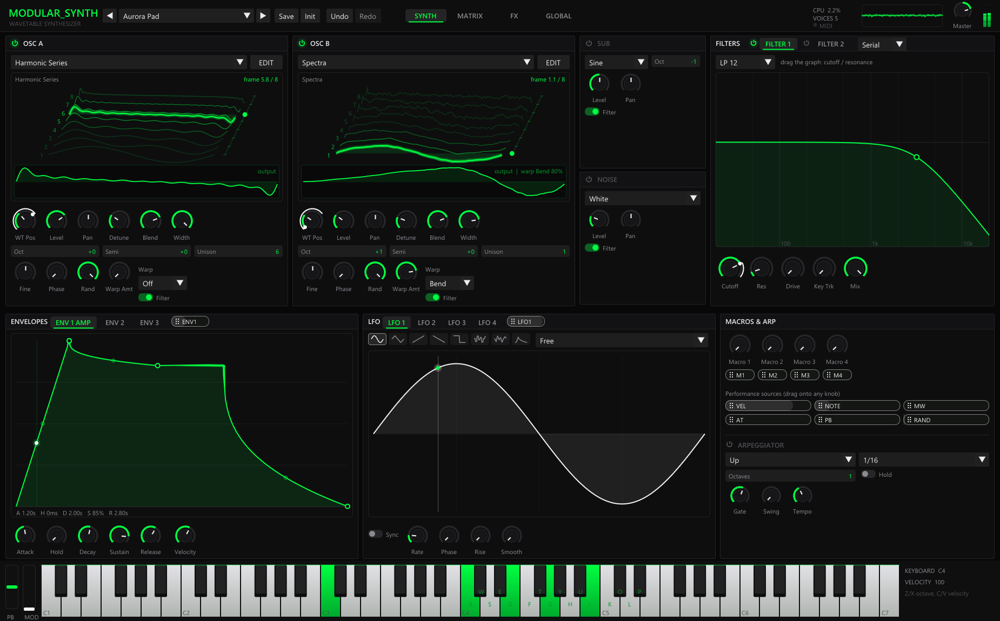

# modular_synth

[](https://github.com/sbeve1/modular-ish-synth/actions/workflows/ci.yml)

A polyphonic wavetable synthesizer for Windows, written in C++. modular_synth has a
real-time audio engine, a GUI built with Dear ImGui, MIDI keyboard support,
and a headless tool for rendering, benchmarking and self-testing.



**Listen:** [docs/demo.wav](docs/demo.wav) (29 s): a pad, a supersaw lead,
a sub bass line, the arpeggiator and a glass pad, all factory presets.
The clip is rendered offline by the engine itself
(`modular_synth_cli showcase docs/demo.wav`), so it is reproducible.

## Features

**Sound**
- 2 wavetable oscillators with 8 morphable frames each, band-limited with FFT
  mipmaps so high notes don't alias
- 9 factory wavetable banks, plus a wavetable editor: draw frames with the mouse,
  generate shapes or harmonics, morph-fill between frames
- Unison up to 16 voices per oscillator (detune, blend, stereo width), 5 warp
  modes (bend, PWM, sync, mirror, fold), a sub oscillator, and noise (white, pink, brown)
- Two multimode zero-delay-feedback filters (LP/BP/HP at 12 and 24 dB, notch,
  peak, drive, key tracking), in series or parallel
- 3 envelopes with curve control and 4 LFOs (7 shapes plus a custom shape you
  draw; free/retrigger/one-shot, tempo sync, rise, smoothing)
- Mod matrix with 32 slots: any source to any parameter, with aux scaling,
  Add/Multiply modes and response curves
- Effects rack with 8 effects in any order (drag to reorder): distortion (5
  modes), phaser, flanger, chorus, ping-pong delay, 8-line FDN reverb, 3-band
  EQ, compressor; plus an output limiter
- Arpeggiator: Up, Down, Up/Down, Random, As Played, Chord; tempo-synced rate,
  1-4 octaves, gate, swing, hold
- Up to 16 voices, poly/mono/legato, glide, sustain pedal
- 16 factory presets; user presets are saved as readable text files

**Playing**
- Audio through Windows audio (WASAPI, shared or exclusive) or an ASIO driver
  (e.g. Focusrite USB ASIO: ~4 ms output latency); start with `--asio` to use ASIO
- MIDI keyboards: notes, velocity, pitch bend, mod wheel, sustain, aftertouch,
  program change, and MIDI learn on any knob
- Computer keyboard: `A W S E D F T G Y H U J K O L P` play notes, `Z`/`X`
  change octave, `C`/`V` change velocity
- On-screen piano (velocity depends on where you click the key), plus pitch and
  mod wheels

**Interface**
- 3D wavetable view (drag to rotate) that follows the playing position
- Knobs show modulation rings and the live modulated value. Drag a mod source
  onto any knob to route it; Alt+drag sets the depth
- Envelope editor with draggable points and curves; LFO view with a live phase
  marker, editable as a drawn shape; draggable filter and EQ response curves;
  compressor transfer curve with a gain-reduction meter
- Undo/redo for everything (Ctrl+Z, Ctrl+Y)
- Oscilloscope, spectrum analyzer, level meters and a CPU graph

## Build (Windows)

Requirements: Visual Studio 2022 with the C++ workload, and CMake 3.15 or newer.
GLFW and Dear ImGui are downloaded automatically when CMake configures.

```bash
cmake -S . -B build/vs -G "Visual Studio 17 2022" -A x64
```

```bash
cmake --build build/vs --config Release
```

This produces:

| Executable | Path | Purpose |
|---|---|---|
| `modular_synth.exe` | `build/vs/app/Release/` | the synthesizer |
| `modular_synth_cli.exe` | `build/vs/app/Release/` | render, benchmark, self-test |
| `Synth.exe` | `build/vs/Release/` | the original console engine |

## Using the CLI

```bash
build/vs/app/Release/modular_synth_cli.exe selftest
```

```bash
build/vs/app/Release/modular_synth_cli.exe render "Aurora Pad" pad.wav
```

```bash
build/vs/app/Release/modular_synth_cli.exe bench
```

```bash
build/vs/app/Release/modular_synth_cli.exe showcase demo.wav
```

`lfotest` checks that every LFO shape at 2, 10 and 40 Hz fully modulates its target. `bench` reports CPU cost for several scenarios plus a breakdown of where the
heaviest one spends its time. `showcase` renders the README demo clip.

`selftest` checks the following:
- every factory preset renders finite, in-range audio and releases all of its voices
- the audio path makes zero heap allocations (counted by overriding `operator new`)
- parameters round-trip between plain and normalized values
- the mod matrix changes the sound
- preset files round-trip
- the arpeggiator, both filter routings and drawn LFO shapes behave as expected
- the lock-free event queue works under a two-thread stress test

GitHub Actions builds everything on Windows and runs `selftest` on every push
and pull request (`.github/workflows/ci.yml`); the executables are attached to
each run as a download.

## Architecture

```
 UI thread (Dear ImGui, vsync)       MIDI thread (RtMidi)
   knobs ─────► ParamStore ◄──────── MIDI learn (CC -> param)
                (atomic floats)
   keys/piano ► SPSC ring            notes/CC ────► SPSC ring
   wavetables,
   LFO curves ► atomic pointer swap (freed after 2 audio callbacks)
   FX order   ► one atomic (a nibble per rack slot)
                        │
                        ▼
              Audio thread (miniaudio callback)
              snapshot params + mod slots (once per block)
              voices: osc A/B + sub + noise ─► filter ─► amp
              mod matrix every 16 samples
              arpeggiator steps every 16 samples on the same thread
              FX rack in user order (8 effects) ─► master ─► limiter
                        │
                        ▼
              Telemetry (atomics): scope, meters, newest voice's
              modulation state ─► read by the UI for visuals
```

- The threads never lock. Parameters are atomics that the audio thread reads
  once per block. Notes go through single-producer/single-consumer rings, one
  ring per producer thread.
- The audio callback allocates nothing; all buffers are created in `prepare()`.
- `app/engine` has no GUI or device code, so the same engine can drive the CLI
  and, later, a WebAssembly/AudioWorklet build.

Measured on this machine (48 kHz, best of 3 runs), after an optimization
pass that cut CPU use 19-32% with no change to the sound:

| Scenario | Speed (× realtime) | CPU at realtime |
|---|---|---|
| Heavy patch (2 osc × 8 unison, sub, noise, 24 dB filter, 4 FX), 1 voice | 105× | ~1% |
| Same, 16 voices | 16× | ~6% |
| Max: 16 voices, 2 × 16 unison, bend + sync warp, 2 filters, all 8 FX | 4.4× | ~23% |
| FX rack only, all 8 effects | 104× | ~1% |

## Project layout

```
app/engine/   instrument, voices, wavetables, filter, LFOs, FX, presets
app/host/     audio device (miniaudio) and MIDI input (RtMidi)
app/ui/       theme, widgets, visualizations, pages, wavetable editor
app/tools/    modular_synth_cli
src/          the original engine (console synth); modular_synth reuses its
              envelope, filter math and SPSC ring design
docs/         DEVLOG.md (development log)
```

## License

MIT. See `LICENSE.txt`.
